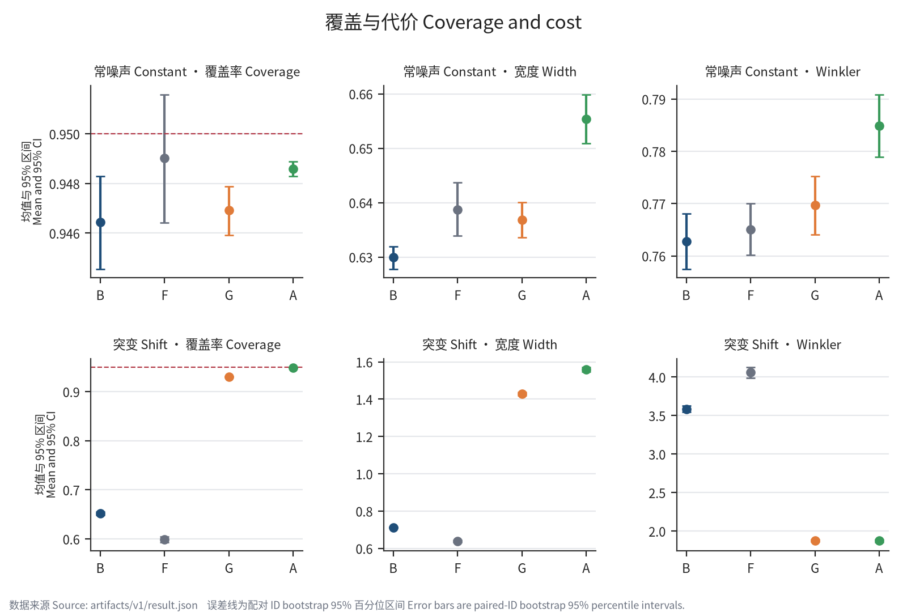
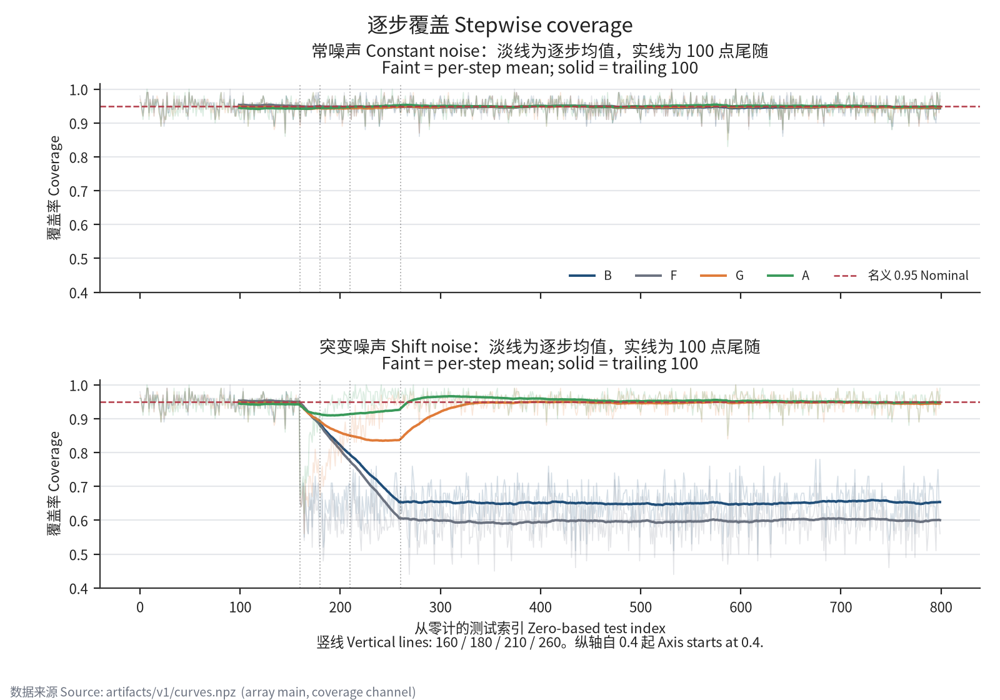
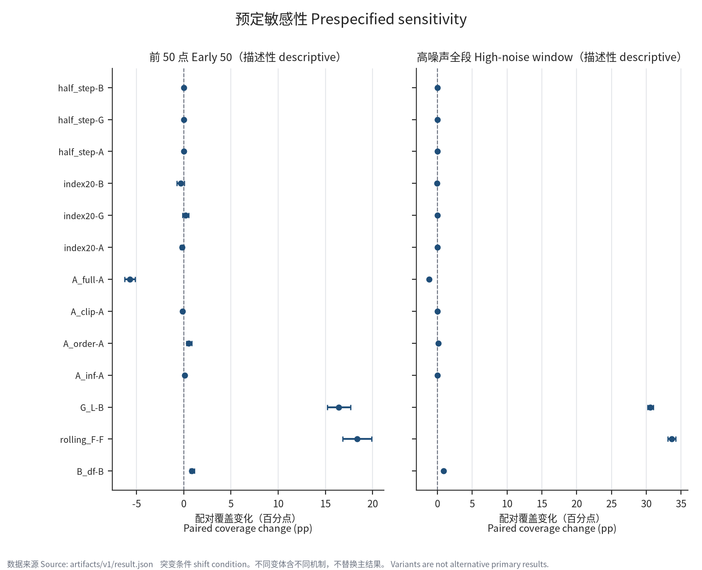

# NEXTrun：NGRC 预测区间独立复核报告

**执行与全部预定 L2 已完成；研究结论由锁定判据决定。** 本报告是对已知原论文表格差距的独立实现检验，不是盲分析，也不是作者代码或原始样本的逐位复现。

在冻结轨道 x* 的观测噪声总体、测试索引 {160,…,799} 且 A 指本稿主约定的范围内，作为对已知原表差距的独立实现检验，基准/负对照统计相容性未通过，主推断被阻断；原始 M/E/J 只作描述。 本次复核因基准质量门未过而未能检验主假设；M/E/J 均为“未检验（质量门关闭）”。原始 E 未达等价阈值（False），G 未满足探索性名义覆盖判据（C95=False）；这些描述性状态不能替代确认性检验。

核心数字未全部接近原表。 本报告的所有区间只度量冻结轨道 x* 上独立观测噪声重复的 Monte Carlo 不确定性；不包括初值、轨道或其他动力系统的泛化不确定性。

## 版本、封存和公开记录

**受 API 限制，本报告属于公开快照锁定，缺乏第三方独立时间戳仲裁（见 [D002](DEVIATIONS.md)）。** 执行前公开读取记录与哈希校验支持版本一致性，但不足以证明具有第三方独立时间戳的强前瞻性预注册。首次公开精确时间待核实。

- 协议锁定提交：`ed8d08bdd29e6084ccb42345896352ea1e62ad8e`；PREREG SHA-256：`9d486db80eb5faca0d5aeb21c60ae80088991514f2360fd99208b22e71c77991`，原件未改。
- 结果前执行冻结提交：`c061a7eafaa1073e0e07bd1a5da3aae3f2fbae62`；源文件清单见 [EXECUTION_SHA256SUMS](EXECUTION_SHA256SUMS)。
- 运行 UTC：`2026-10-08T14:57:35.977862+00:00` 至 `2026-10-08T15:03:30.974176+00:00`；墙钟 355.00 秒，峰值 RSS 72.72 MiB。300/300 次拟合尝试完成，单进程、BLAS 单线程，无 GPU。
- 封存结果 SHA-256：`a07981a8d6a90d19836c089f3ae211a00f8f3c73b348b1d2c4eec1e2d09ea7cb`；[完整结果 JSON](evaluation/result.json)、[全部产物哈希](evaluation/artifact_manifest.json)、[尝试清单](evaluation/attempts.json)。
- [执行前公开读取记录](evidence/public_lock.json)确认匿名可读且协议哈希相同；GitHub events 接口 403，首次公开精确时间待核实。读取时间不是首次 push 时间；未使用本地 Git 时间冒充公开时间戳。
- [偏离登记](DEVIATIONS.md)：用户指定的两小时硬限、首次公开时间证据限制，以及复用固定系统依赖的环境隔离限制；方法、种子、窗口与统计门槛保持预注册约定。

## 实现、验收与独立复算

主实现采用同步 Euler、20 个带噪滞后、231 列特征和含截距惩罚的岭回归（Gram 加 16I）。两条件共享创新与拟合；测试期每次先固定所有区间，再揭示 y。预测和历史接口接收 owning copy 且只读，更新返回新状态。A 的主约定为 100 残差线性分位数、[0,1] 投影，不冒称为已核实的作者实现。

11 项结果前验收通过，覆盖特征/惩罚、同步积分、观测映射与索引、历史隔离/防泄漏、端点/Winkler、A 更新、质量门、线性 J 和结论优先级。见 [验收记录](validation_before_run.txt) 与 [测试](tests/test_protocol.py)。

独立 [recompute.py](scripts/recompute.py) 不导入主实现，重积分两条轨道、复核 300 次拟合，重新检查 3,040,000 个逐点区间的预测前半宽、全部覆盖/宽度/Winkler、种子级汇总、bootstrap 和门控；耗时 1037.93 秒。覆盖和宽度 atol=1e−12，Winkler atol=rtol=1e−10，全部通过。这里“独立”指独立代码路径与公式重写，不是独立团队审稿。见 [独立复算记录](evaluation/independent_recompute.json)。

## 主结果与原表参照

下表为突变条件的高噪声窗口 {160,…,799}；每个种子先汇总再等权平均，SE 的统计单位为 100 个噪声重复。作者数字来自 [论文 v1 表 1](https://arxiv.org/html/2609.32169v1#S5.SS4)，不是本次结果；作者 A 的窗口、分位数与投影约定仍不唯一。

单位约定：覆盖率及其区间用概率小数；覆盖差、配对差及其 SE/区间默认用概率小数差。明确标注“百分点（pp）”的列、文字与图采用百分点，1 pp = 0.01 概率差；Δ/SE 与比值无量纲，宽度相对差用百分比。本次仅补明单位，保留全部数值。

| 方法 | 原表覆盖 | 本次覆盖 ± SE | 95% 区间 | 覆盖差（百分点 pp） | 均宽 ± SE | Winkler ± SE | 宽度相对原表差 |
|---|---:|---:|---|---:|---:|---:|---:|
| B | 0.726 | 0.651609 ± 0.001801 | [0.648016, 0.655079] | -7.439 | 0.712840 ± 0.001365 | 3.585877 ± 0.021663 | -16.92% |
| F | 0.595 | 0.599203 ± 0.002929 | [0.593625, 0.604953] | +0.420 | 0.638737 ± 0.002508 | 4.059391 ± 0.034128 | -0.97% |
| G | 0.929 | 0.929750 ± 0.000618 | [0.928500, 0.930953] | +0.075 | 1.428581 ± 0.004240 | 1.878166 ± 0.008341 | -2.02% |
| A | 0.938 | 0.948937 ± 0.000232 | [0.948484, 0.949391] | +1.094 | 1.559282 ± 0.005907 | 1.874156 ± 0.008444 | +0.99% |

原文没有 Winkler 参照值。原文 B/G 高噪声 SE 均舍入为 0.001，A 为 0.000；舍入零不意味着没有不确定性。

| 方法 | 本次 SE / 作者显示 SE | 点差 / 本次 SE |
|---|---:|---:|
| B | 1.800588 | -41.314636 |
| G | 0.618224 | 1.213153 |
| A | N/A | 47.198325 |

图 1：常噪声全测试段与突变条件高噪声全段的覆盖、均宽和 Winkler；误差线为按重复 ID 配对 bootstrap 的 95% 百分位区间。较高覆盖、接近 95% 与较低代价是不同判断。

## 质量门与固定序列

六项 N-F 采用同一 10,000×100 重采样 ID 表，分位概率 0.05/12 与 1−0.05/12，端点相交仍相容。作者目标值仅作固定参照；这不是两篇研究的总体相等检验。

| 条件/窗口/方法 | 覆盖差（概率小数差） | SE（概率小数） | Bonferroni 相容区间（覆盖率） | 容差带（覆盖率） | 状态 |
|---|---:|---:|---|---|---|
| shift/high/B | -0.074391 | 0.001801 | [0.64690625, 0.6562083984375] | [0.6759999999999999, 0.776] | 不相容 |
| shift/high/F | 0.004203 | 0.002929 | [0.5915933593749999, 0.60703125] | [0.575, 0.615] | 相容 |
| constant/all/B | 0.005437 | 0.000937 | [0.94390828125, 0.9488167187500002] | [0.9209999999999999, 0.961] | 相容 |
| constant/all/F | 0.000013 | 0.001322 | [0.94557078125, 0.952554375] | [0.9289999999999999, 0.969] | 相容 |
| constant/all/G | -0.000088 | 0.000493 | [0.9456, 0.9481875] | [0.9269999999999999, 0.967] | 相容 |
| constant/all/A | -0.000412 | 0.000152 | [0.9481875000000002, 0.9489875000000001] | [0.9289999999999999, 0.969] | 相容 |

N：未通过；N-F：未通过。资格与主设置门控状态保持独立，不被 L2 结果回写。

下表 M/E 的点估计和区间单位为概率小数差；J 使用各自的宽度或 Winkler 代价单位。

| 判据 | 点估计 | 预定区间 | 原始数值判据 | 门控状态 |
|---|---:|---|---|---|
| M (G-B) | 0.278141 | [0.274219, 0.282125] | True | 未检验（质量门关闭） |
| E (G-A) | -0.019188 | [-0.020203, -0.018188] | False | 未检验（质量门关闭） |
| J (width: G−1.10A) | -0.286629 | [-0.294033, -0.279028] | True（联合） | 未检验（质量门关闭） |
| J (winkler: G−1.10A) | -0.183406 | [-0.188732, -0.178006] | True（联合） | 未检验（质量门关闭） |

门槛使用未舍入值：M 的 95% 下界 >0.15；E 的 90% 区间完全在 (−0.02,0.02)；J 两项 90% 上界都 <0。质量门关闭时，原始布尔值不能支持主假设；失败不能解释为没有任何收益或论文错误。

在当前封存结果与锁定判据不变的前提下，即使质量门处于开放状态，原始 E 判据自身亦未通过预注册等价阈值：G−A 的 90% 区间为 [-0.020203, -0.018188]，下界越过 −0.02，故 E=False。固定序列会在 E 停止，不能因原始 M=True、J=True 就支持主假设。这一反事实说明不重开实际门控，也不预测将来修复或重跑后的结果。

在冻结轨道 x* 的观测噪声总体、测试索引 {160,…,799} 且 A 指本稿主约定的范围内，作为对已知原表差距的独立实现检验，基准/负对照统计相容性未通过，主推断被阻断；原始 M/E/J 只作描述。 前 50 点 G−B=11.100 个百分点，SE=0.529，95% 配对区间 [10.060, 12.140] 个百分点（无确认性资格）。 覆盖结论不附带宽度复现（B 相对差 -16.92%）。 J 门控状态：未检验（质量门关闭）。 J 两项线性差及描述比值均未触发 |b|>0.1 旗标；这不证明区间覆盖准确。

| J 量/描述比值 | 点估计 | 90% 区间 | bootstrap 均值 | bias | SEboot | b | 旗标 |
|---|---:|---|---:|---:|---:|---:|---|
| width/D | -0.286629 | [-0.294033, -0.279028] | -0.286539 | 0.000090293 | 0.004570 | 0.019759 | False |
| width/ratio | 0.916179 | [0.912203, 0.920305] | 0.916234 | 0.000055298 | 0.002456 | 0.022512 | False |
| winkler/D | -0.183406 | [-0.188732, -0.178006] | -0.183364 | 0.000041585 | 0.003307 | 0.012574 | False |
| winkler/ratio | 1.002140 | [0.999561, 1.004816] | 1.002162 | 0.000022539 | 0.001620 | 0.013915 | False |

描述比值采用跨种子均值之比，不参与 J。所有方法/窗口 Winkler、预定有限 Winkler 差、D 和比值的诊断均见 [完整诊断 CSV](evaluation/bootstrap_diagnostics.csv)；非法无穷代价差未计算。

G 未满足探索性的接近名义覆盖判据。探索性 C95（高噪声 90% 区间严格在 (0.93,0.97) 内）：B=False；F=False；G=False；A=True。这不是证明真实覆盖至少 95%。

## 时间窗口与适应过程

160 时目标首次高噪声而全部滞后仍低噪声；179 时 19 个高噪声滞后；180 起全部 20 个滞后高噪声。G/主 A 在 160/180/260 的残差 ID 分别为 60–159、80–179、160–259；高噪声主窗口的 540/640 个时刻有全高噪声残差历史。这不保证稳态，也不能用窗口比较因果分离两种过渡。

图 2：淡线为 100 次重复逐测试步平均命中，实线为完整 100 点尾随平均，虚线标记 160/180/210/260 与名义覆盖。只描述适应过程，不逐步做显著性检验。

| 条件 | 窗口 | 方法 | 覆盖 ± SE | 均宽 ± SE | Winkler ± SE |
|---|---|---|---:|---:|---:|
| constant | all | B | 0.946437 ± 0.000937 | 0.629920 ± 0.001077 | 0.762766 ± 0.002731 |
| constant | all | F | 0.949013 ± 0.001322 | 0.638737 ± 0.002508 | 0.765051 ± 0.002565 |
| constant | all | G | 0.946912 ± 0.000493 | 0.636819 ± 0.001649 | 0.769751 ± 0.002853 |
| constant | all | A | 0.948588 ± 0.000152 | 0.655402 ± 0.002276 | 0.784913 ± 0.003069 |
| constant | pre | B | 0.947938 ± 0.001942 | 0.629741 ± 0.001068 | 0.755897 ± 0.006506 |
| constant | pre | F | 0.951063 ± 0.002057 | 0.638737 ± 0.002508 | 0.757927 ± 0.005968 |
| constant | pre | G | 0.945563 ± 0.001485 | 0.631096 ± 0.003147 | 0.762644 ± 0.006217 |
| constant | pre | A | 0.943437 ± 0.000718 | 0.636122 ± 0.004802 | 0.774676 ± 0.006568 |
| constant | early50 | B | 0.946200 ± 0.003162 | 0.629973 ± 0.001081 | 0.769529 ± 0.010862 |
| constant | early50 | F | 0.949400 ± 0.002960 | 0.638737 ± 0.002508 | 0.771197 ± 0.010285 |
| constant | early50 | G | 0.945000 ± 0.002987 | 0.637606 ± 0.004298 | 0.779334 ± 0.011156 |
| constant | early50 | A | 0.950400 ± 0.002674 | 0.662805 ± 0.006942 | 0.795779 ± 0.011293 |
| constant | transition20 | B | 0.951000 ± 0.004819 | 0.630299 ± 0.001087 | 0.755094 ± 0.017259 |
| constant | transition20 | F | 0.955000 ± 0.004794 | 0.638737 ± 0.002508 | 0.759854 ± 0.016905 |
| constant | transition20 | G | 0.950000 ± 0.004820 | 0.637210 ± 0.004569 | 0.762145 ± 0.017605 |
| constant | transition20 | A | 0.957000 ± 0.003958 | 0.665132 ± 0.007981 | 0.778625 ± 0.018089 |
| constant | pure30 | B | 0.943000 ± 0.004245 | 0.629756 ± 0.001102 | 0.779153 ± 0.014546 |
| constant | pure30 | F | 0.945667 ± 0.003868 | 0.638737 ± 0.002508 | 0.778759 ± 0.014125 |
| constant | pure30 | G | 0.941667 ± 0.004003 | 0.637870 ± 0.004327 | 0.790794 ± 0.014533 |
| constant | pure30 | A | 0.946000 ± 0.003632 | 0.661254 ± 0.006917 | 0.807215 ± 0.014136 |
| constant | high | B | 0.946063 ± 0.001006 | 0.629964 ± 0.001081 | 0.764484 ± 0.003080 |
| constant | high | F | 0.948500 ± 0.001408 | 0.638737 ± 0.002508 | 0.766832 ± 0.002941 |
| constant | high | G | 0.947250 ± 0.000589 | 0.638250 ± 0.001818 | 0.771527 ± 0.003224 |
| constant | high | A | 0.949875 ± 0.000251 | 0.660222 ± 0.002473 | 0.787472 ± 0.003427 |
| shift | all | B | 0.710875 ± 0.001531 | 0.696220 ± 0.001272 | 3.019881 ± 0.017492 |
| shift | all | F | 0.669575 ± 0.002509 | 0.638737 ± 0.002508 | 3.399099 ± 0.027376 |
| shift | all | G | 0.932913 ± 0.000524 | 1.269084 ± 0.003509 | 1.655061 ± 0.006694 |
| shift | all | A | 0.947838 ± 0.000169 | 1.374650 ± 0.004825 | 1.654260 ± 0.006838 |
| shift | pre | B | 0.947938 ± 0.001942 | 0.629741 ± 0.001068 | 0.755897 ± 0.006506 |
| shift | pre | F | 0.951063 ± 0.002057 | 0.638737 ± 0.002508 | 0.757927 ± 0.005968 |
| shift | pre | G | 0.945563 ± 0.001485 | 0.631096 ± 0.003147 | 0.762644 ± 0.006217 |
| shift | pre | A | 0.943437 ± 0.000718 | 0.636122 ± 0.004802 | 0.774676 ± 0.006568 |
| shift | early50 | B | 0.648400 ± 0.006402 | 0.694515 ± 0.002399 | 3.590871 ± 0.072287 |
| shift | early50 | F | 0.607800 ± 0.007928 | 0.638737 ± 0.002508 | 3.949687 ± 0.089174 |
| shift | early50 | G | 0.759400 ± 0.004811 | 0.896694 ± 0.007554 | 2.728565 ± 0.050002 |
| shift | early50 | A | 0.883000 ± 0.002484 | 1.324631 ± 0.019643 | 2.222558 ± 0.041353 |
| shift | transition20 | B | 0.651000 ± 0.010707 | 0.667142 ± 0.002317 | 3.488778 ± 0.121898 |
| shift | transition20 | F | 0.624000 ± 0.012298 | 0.638737 ± 0.002508 | 3.674119 ± 0.138875 |
| shift | transition20 | G | 0.703500 ± 0.008940 | 0.746635 ± 0.006430 | 3.094645 ± 0.100865 |
| shift | transition20 | A | 0.799500 ± 0.005527 | 1.002329 ± 0.021327 | 2.598940 ± 0.085811 |
| shift | pure30 | B | 0.646667 ± 0.007713 | 0.712764 ± 0.003116 | 3.658934 ± 0.096155 |
| shift | pure30 | F | 0.597000 ± 0.008978 | 0.638737 ± 0.002508 | 4.133398 ± 0.113556 |
| shift | pure30 | G | 0.796667 ± 0.006955 | 0.996734 ± 0.008946 | 2.484511 ± 0.071404 |
| shift | pure30 | A | 0.938667 ± 0.003661 | 1.539499 ± 0.023683 | 1.971637 ± 0.041660 |
| shift | high | B | 0.651609 ± 0.001801 | 0.712840 ± 0.001365 | 3.585877 ± 0.021663 |
| shift | high | F | 0.599203 ± 0.002929 | 0.638737 ± 0.002508 | 4.059391 ± 0.034128 |
| shift | high | G | 0.929750 ± 0.000618 | 1.428581 ± 0.004240 | 1.878166 ± 0.008341 |
| shift | high | A | 0.948937 ± 0.000232 | 1.559282 ± 0.005907 | 1.874156 ± 0.008444 |

## 全部预定 L2

步长减半轨道 x 的最大绝对差 0.00125576104，RMS 差 0.000886669137；这里比较的是规定数值路径变体，不能假称同一 x*，也不建立轨道总体。

敏感旗标：S_M=False，S_E数值=False，S_E算法=True；全部 L2 完成。以下原始门槛仅描述，不重开确认序列。

| 积分/索引变体 | B/G/A 覆盖变化（百分点 pp） | 原始 M（是否翻转） | 原始 E（是否翻转） |
|---|---|---|---|
| half_step | B: -0.0016 pp；G: +0.0016 pp；A: +0.0000 pp | True (False) | False (False) |
| index20 | B: -0.0516 pp；G: +0.0000 pp；A: -0.0156 pp | True (False) | False (False) |

| 比较（突变高噪声） | 覆盖配对差 ± SE（概率小数差） | 95% 区间（概率小数差） | Δ/SE | 均宽差 ± SE | Winkler 差 ± SE |
|---|---:|---|---:|---:|---:|
| half_step-B | -0.000016 ± 0.000016 | [-0.000047, 0.000000] | -1.000000 | -0.000000 ± 0.000000 | -0.000002 ± 0.000002 |
| half_step-G | 0.000016 ± 0.000016 | [0.000000, 0.000047] | 1.000000 | -0.000001 ± 0.000000 | -0.000001 ± 0.000001 |
| half_step-A | 0.000000 ± 0.000000 | [0.000000, 0.000000] | zero difference | -0.000001 ± 0.000001 | -0.000001 ± 0.000001 |
| index20-B | -0.000516 ± 0.000227 | [-0.000953, -0.000094] | -2.276067 | -0.000062 ± 0.000054 | 0.000764 ± 0.001026 |
| index20-G | 0.000000 ± 0.000131 | [-0.000250, 0.000250] | 0.000000 | -0.000023 ± 0.000157 | 0.000264 ± 0.000483 |
| index20-A | -0.000156 ± 0.000075 | [-0.000312, -0.000016] | -2.074692 | 0.001721 ± 0.001093 | 0.000693 ± 0.000866 |
| A_full-A | -0.011891 ± 0.000319 | [-0.012516, -0.011266] | -37.223076 | -0.050338 ± 0.003640 | 0.034441 ± 0.002858 |
| A_clip-A | -0.000219 ± 0.000054 | [-0.000328, -0.000125] | -4.014509 | -0.000638 ± 0.001045 | -0.000739 ± 0.000448 |
| A_order-A | 0.001359 ± 0.000153 | [0.001062, 0.001656] | 8.866814 | 不可估计（含∞） | 不可估计（含∞） |
| A_inf-A | 0.000094 ± 0.000037 | [0.000031, 0.000172] | 2.513792 | 不可估计（含∞） | 不可估计（含∞） |
| G_L-B | 0.305875 ± 0.002095 | [0.301796, 0.310047] | 146.024672 | 0.939147 ± 0.005997 | -1.666467 ± 0.016561 |
| rolling_F-F | 0.336516 ± 0.002926 | [0.330766, 0.342125] | 114.991896 | 0.829948 ± 0.005919 | -2.185536 ± 0.029763 |
| B_df-B | 0.008797 ± 0.000337 | [0.008141, 0.009453] | 26.138041 | 0.013504 ± 0.000042 | -0.078897 ± 0.000493 |
| G-B_df | 0.269344 ± 0.001941 | [0.265578, 0.273172] | 138.791469 | 0.702237 ± 0.003723 | -1.628814 ± 0.017011 |

所有条件与窗口的种子内配对差、SE、95% 区间、Δ/SE 及代价偏差诊断见完整 JSON，不对短窗口套用 1 个百分点工程容差。

图 3：预定比较在前 50 点及高噪声全段的配对覆盖变化和 95% 区间。不同变体含不同机制，不按接近原表程度选取替代主结果。

| A 单因素变体 | G−变体覆盖差（概率小数差） | 90% 区间（概率小数差） | 原始 E | 相对主 E 翻转 |
|---|---:|---|---|---|
| A_full | -0.007297 | [-0.008266, -0.006374] | True | True |
| A_clip | -0.018969 | [-0.019969, -0.017984] | True | True |
| A_order | -0.020547 | [-0.021562, -0.019547] | False | False |
| A_inf | -0.019281 | [-0.020313, -0.018266] | False | False |

A_full 只改全部校准及已揭示历史；A_clip 只改投影 [0.001,0.999]；A_order 只改有限样本顺序统计量；A_inf 只改 α=0 时为全实数区间。各自按自己的 miss 更新 α。端点及其后续反馈的总影响不等于作者早期 0.832 的因果分解。

| 突变窗口 | A 方法 | 覆盖 ± SE | 均宽 | Winkler | 无穷点/总点 | 含无穷种子/100 | α=0 | α<0.01 | 半宽=历史最大 |
|---|---|---:|---:|---:|---|---|---:|---:|---:|
| early50 | A | 0.883000 ± 0.002484 | 1.324631 | 2.222558 | 0/5000 | 0/100 | 98 | 2292 | 98 |
| early50 | A_full | 0.825800 ± 0.003144 | 1.114100 | 2.452638 | 0/5000 | 0/100 | 311 | 3195 | 314 |
| early50 | A_clip | 0.881800 ± 0.002622 | 1.318013 | 2.219161 | 0/5000 | 0/100 | 0 | 2252 | 0 |
| early50 | A_order | 0.888400 ± 0.002608 | ∞ | ∞ | 423/5000 | 41/100 | 0 | 423 | 1536 |
| early50 | A_inf | 0.884000 ± 0.002445 | ∞ | ∞ | 93/5000 | 54/100 | 93 | 2290 | 0 |
| transition20 | A | 0.799500 ± 0.005527 | 1.002329 | 2.598940 | 0/2000 | 0/100 | 32 | 629 | 32 |
| transition20 | A_full | 0.739000 ± 0.007507 | 0.842809 | 2.915790 | 0/2000 | 0/100 | 70 | 573 | 70 |
| transition20 | A_clip | 0.799000 ± 0.005550 | 0.999754 | 2.596585 | 0/2000 | 0/100 | 0 | 629 | 0 |
| transition20 | A_order | 0.810000 ± 0.005318 | ∞ | ∞ | 133/2000 | 19/100 | 0 | 133 | 392 |
| transition20 | A_inf | 0.801000 ± 0.005458 | ∞ | ∞ | 30/2000 | 26/100 | 30 | 629 | 0 |
| pure30 | A | 0.938667 ± 0.003661 | 1.539499 | 1.971637 | 0/3000 | 0/100 | 66 | 1663 | 66 |
| pure30 | A_full | 0.883667 ± 0.004750 | 1.294960 | 2.143869 | 0/3000 | 0/100 | 241 | 2622 | 244 |
| pure30 | A_clip | 0.937000 ± 0.003817 | 1.530185 | 1.967545 | 0/3000 | 0/100 | 0 | 1623 | 0 |
| pure30 | A_order | 0.940667 ± 0.003657 | ∞ | ∞ | 290/3000 | 29/100 | 0 | 290 | 1144 |
| pure30 | A_inf | 0.939333 ± 0.003557 | ∞ | ∞ | 63/3000 | 43/100 | 63 | 1661 | 0 |
| high | A | 0.948937 ± 0.000232 | 1.559282 | 1.874156 | 0/64000 | 0/100 | 128 | 4331 | 130 |
| high | A_full | 0.937047 ± 0.000347 | 1.508944 | 1.908597 | 0/64000 | 0/100 | 1239 | 30115 | 1312 |
| high | A_clip | 0.948719 ± 0.000243 | 1.558644 | 1.873417 | 0/64000 | 0/100 | 0 | 4297 | 0 |
| high | A_order | 0.950297 ± 0.000232 | ∞ | ∞ | 622/64000 | 50/100 | 0 | 622 | 3266 |
| high | A_inf | 0.949031 ± 0.000227 | ∞ | ∞ | 122/64000 | 63/100 | 122 | 4318 | 2 |

| 重点端点比较（突变条件） | 窗口 | 覆盖配对差 ± SE（概率小数差） | 95% 区间（概率小数差） |
|---|---|---:|---|
| A_inf-A | early50 | 0.001000 ± 0.000438 | [0.000200, 0.002000] |
| A_inf-A | transition20 | 0.001500 ± 0.000857 | [0.000000, 0.003500] |
| A_inf-A | pure30 | 0.000667 ± 0.000469 | [0.000000, 0.001667] |
| A_inf-A | high | 0.000094 ± 0.000037 | [0.000031, 0.000172] |
| A_order-A | early50 | 0.005400 ± 0.001417 | [0.002800, 0.008200] |
| A_order-A | transition20 | 0.010500 ± 0.002955 | [0.005000, 0.016500] |
| A_order-A | pure30 | 0.002000 ± 0.002055 | [-0.002000, 0.006333] |
| A_order-A | high | 0.001359 ± 0.000153 | [0.001062, 0.001656] |

无穷半宽按全实数区间记覆盖，均宽/Winkler 为正无穷。只要任一种子窗口含无穷，该比较的普通代价配对差、SE、bootstrap 与偏差比都不可估计；没有删除这些点，没有计算 ∞−∞。两侧有限时才汇总代价差。两条件、全部六窗口的分母及计数均保留于 JSON。

测度说明：对非负代价 X，若经验分布在 +∞ 处有正质量，则扩展实数均值 ∫X dP̂=+∞；bootstrap 重采样均值也有正概率为 +∞，通常的有限均值、SE 与中心化偏差不再适用。并非每次重采样都必为无穷，不能丢弃非有限重采样来构造常规区间。

G+L 路径包含 G，所有种子窗口和相同 bootstrap ID 的嵌套单调性检查通过。M-L 原始门槛=True，仅为杠杆对齐诊断，不是第二次确认。rolling SCP 固定为 100 个绝对残差的第 96 顺序统计量。

B-df：主设置 df 范围 [56.83603, 61.17487]，尺度倍数 [1.018249, 1.019683]（理论上界 40/37）。G−B-df 原始 M 门槛=True。该分母不是无偏尺度估计，不用于替换主 M 或归因作者欠覆盖；全部拟合 df/尺度在 [拟合诊断](evaluation/fit_diagnostics.json)。

## 失败、未解原因与范围

质量门失败项：shift/high/B。只做静态审计，没有为过门改参数、替换种子、延长窗口或选择 L2。

核心观察是两条件反差：B 在 constant/all 的覆盖差为 +0.005437（SE 0.000937，概率小数差），落在预定相容范围内；在 shift/high 的覆盖为 0.651609，对照原表 0.726，覆盖差为 −0.074391（SE 0.001801，概率小数差），宽度相对原表差为 −16.92%。相容不是完全一致；这一反差提示优先核对噪声突变下的尺度与输入过渡处理，不能据此排除只在突变条件显现的实现错误。

本协议 B 的半宽为 z·τfit·√(1+ℓt)：τfit 来自训练样本内 RMS，测试期固定，不使用校准残差或滚动历史；突变后的带噪滞后只通过预测中心与杠杆 ℓt 影响 B。因此，可优先核对的技术假说是：固定低噪声尺度与突变后预测残差尺度失配，以及输入噪声过渡经非线性特征影响杠杆的方式。训练尺度冻结能够解释本实现为何可能欠覆盖，却不能单独解释与原表的差距；需作者逐时刻尺度、杠杆和残差记录才能核对双方约定是否一致。

历史截断与残差尺度更新是 G/A 适应过程的待核对机制：100 个已揭示残差由低噪声逐步替换为高噪声，平方残差或分位数会有过渡滞后；它们不直接进入 B，不能直接归因为 B 门失败。常噪声相容与预定积分/索引变体的结果，也不足以证明基础拟合无误。这些是基于冻结公式的后续核对假说，未新增实验，未确证因果。

独立代码路径复核了观测映射、231 列特征、nλ=16、截距惩罚、训练 RMS、校准独立性、杠杆、测试前残差历史和全部区间；未发现能解释差距的共有实现错误。作者代码/逐重复数据不可得，无法把统计不相容归因为某个单独原因；仍保留本实现未捕获错误的可能。A 的约定不确定性另影响 G−A 的解释，不能用于解释 B 的失配。

本次主假设未能检验，不能将门失败当作原论文错误的证据。另须区分资格问题与原始数值判据：即使仅假设质量门开放，当前原始 E 仍未达等价阈值，故本组封存结果不会自动支持主假设。

原论文已经讨论近期误差和顺序更新。本次不把它描述为首次发现。B/G 除尺度来源外还有杠杆因子、样本内/外残差与噪声水平差异；比较不能隔离在线更新的单独因果效应。A 的独立主约定不匹配原文数值不能证明作者错误。

登记证据也有边界：本报告采用公开快照锁定与哈希核验，缺乏第三方独立时间戳仲裁（D002），不能等同于已取得不可篡改时间证明的强前瞻性预注册。

百分位 bootstrap、六项相容区间和固定序列只承诺名义/近似误差控制，不保证有限样本精确覆盖；未追加 BCa、种子或事后阈值。

## 复现与交付

见 [执行说明](EXECUTION.md)、[README](README.md)、[精确依赖](requirements.lock)。本地 `artifacts/v1/` 保存创新、带噪观测、划分、拟合、逐点区间及统一 bootstrap ID；全部原始文件均有哈希且不入库。仓库只含小型结果、种子级汇总、图和元数据；不含论文全文、作者图或大文件。

中文单帖 [x_post_cn.md](x_post_cn.md) 与英文串帖 [x_post.md](x_post.md) 均为草稿，未发送。仅本地中文提交，不 push。
